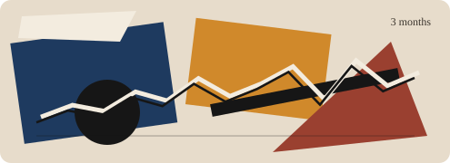
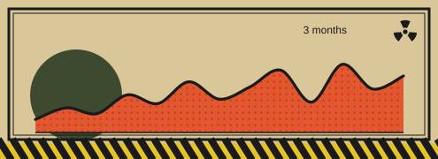
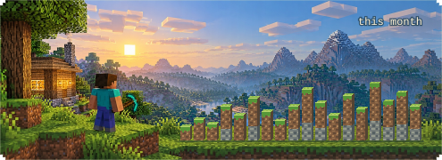
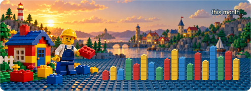
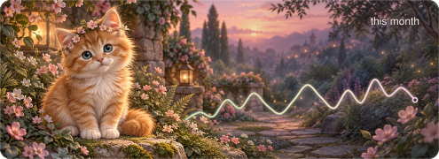
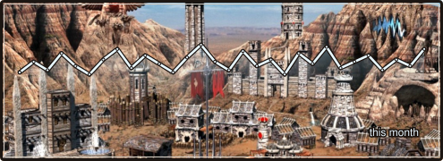
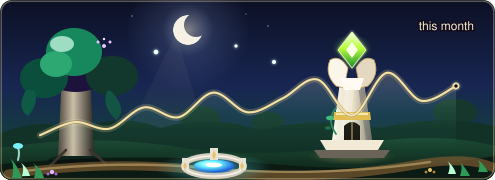
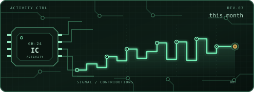

# Themed activity badges

Ten cards for a GitHub profile README. Each one shows the current calendar month, from the 1st through today. It resets on the 1st: October starts as a single day.

Live numbers come from a Node server (`server.js`). It fetches the contribution calendar from GitHub and draws an SVG. Files in `badges/` are visual templates; they do not know which account they belong to. The corner reads like `349 contributions` plus the month (`September`, `October`). Each day is a peak labeled with that day's count. Height is scaled to the busiest day in the month.

Anime, Cats, and Automotive embed panoramic artwork in the template (`badges/assets/`). Each scene continues naturally behind the chart, keeping its main subject clear of the curve. Cats pairs a flower-crowned kitten with a blush-and-sage twilight garden. Automotive places a crimson sports car on a wet waterfront at blue hour. Anime uses a warmly lit evening study and rainy window. Their softly glowing activity curves match the artwork's colors. The server replaces the curve, the day counts, and the corner total.

LEGO and Minecraft also use panoramic artwork, with daily bars built from editable SVG geometry. LEGO stacks colored plastic bricks with studs, seams, and shaded sides. Minecraft builds pixel-textured dirt and stone columns topped with grass. Both keep their main character clear of the chart; the server updates every column, day count, and corner total.

```bash
node server.js
```

Public URL: `https://gh-badges-nine.vercel.app`. In the examples below the login is `username` — replace it with yours. Locally the same path is `http://127.0.0.1:8787/fallout?user=username`. An optional `GITHUB_TOKEN` switches the request to the official GraphQL API.

## How to embed

Paste one of the lines below into your profile `README.md`. Each card has its own background, so it looks fine on both light and dark themes.

## Themes

### Cubism



```html

```

### Fallout



```html

```

### Minecraft

An explorer with a diamond pickaxe beside an oak cabin, overlooking a cubic Overworld valley at sunrise. Daily activity forms grass-topped columns with pixel dirt and stone textures, crisp block edges, and monospaced labels. Artwork: `badges/assets/minecraft-overworld.jpg`; generation prompt: `badges/assets/minecraft-overworld.prompt.md`.



```html

```

### LEGO

A builder minifigure and a miniature brick-built town at sunset, with daily activity stacked on the studded baseplate. Colored towers have visible brick seams, round studs, highlights, and shaded sides. Artwork: `badges/assets/lego-workshop.jpg`; generation prompt: `badges/assets/lego-workshop.prompt.md`.



```html

```

### Anime

Panoramic anime illustration with warm lamplight, a rainy blue-hour window, and a softly glowing sage-to-amber activity curve. The continuous background keeps the character clear of the chart. Artwork: `badges/assets/anime-study.jpg`; generation prompt: `badges/assets/anime-study.prompt.md`.


```html

```

### Cats

Fluffy ginger kitten with a flower crown in a continuous twilight garden, with soft pink blossoms, sage foliage, and a glowing sage-to-blush activity curve. Artwork: `badges/assets/cats-garden.jpg`; generation prompt: `badges/assets/cats-garden.prompt.md`.



```html

```

### Mountain

Stronghold under a clear sky. The activity line is an ice-blue ridgeline, with a dot on each day.



```html

```

### Automotive

Crimson sports car on a rain-darkened waterfront at blue hour, with detailed reflections and a glowing coral-to-amber activity curve beside the car. Artwork: `badges/assets/automotive-waterfront.jpg`; generation prompts: `badges/assets/automotive-waterfront.prompt.md`.


```html

```

### Elvish

Heroes of Might and Magic III town: the activity curve is a gold road across the meadow.



```html

```

### Circuits

PCB-inspired controller board with an orthogonal activity trace, glowing signal vias, copper routes, and an output test pad.



```html

```
